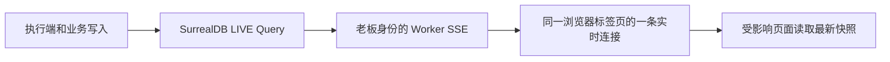

# 老板端工作台与实时运行大盘

## 本地设计预览

仓库根目录执行 `pnpm owner:demo`，打开 <http://127.0.0.1:6006>，点击「进入本地设计预览」。命令安装老板端依赖；不需要数据库、生产凭证或身份服务。

页面使用仓库中的脱敏生产快照及标有【设计案例】的虚构数据。主机、资源指标和交接示例均为虚构，独立标注。岗位与人数取自同一份员工预览数据，仅补产品、工程、QA 这些已有业务岗位的设计案例；模型缺失时显示未知。「演示一次交接」依次模拟工程交付 QA 复核、QA 退回返工。写操作只改变进程内存；重置按钮或重启恢复初始数据。

## 页面分工

| 入口 | 内容 |
| --- | --- |
| 总览 | 主机 → Agent 运行画布、当前任务和提示词、候选下一条、任务下一站、交接与最近事件 |
| 需求 | 产品反馈、需求编辑与确认、实施进度、GitHub 上线核验 |
| 执行任务 | 任务详情、执行与复核证据、直接派工 |
| 派工消息 | 调度队列、待发提示词、修改与扣住/放行 |
| 笔记 | 派工时附带的知识与线笔记 |
| 员工与权限 | 员工策略、身份与命令保护 |
| 运维 | 命令目录、执行作业、操作审计与身份配置 |

不新增第二个 Dashboard 或插件页面。总览替换原有统计卡片页面，其余入口继续承担原来的业务。

## 确认一次的迭代流程

老板确认需求 → 产品核对计划 → 工程实施、QA 独立复核 → 既有工程员工合并 PR 并核验 GitHub 自动部署 → QA 线上验收 → 已上线。

- 开工确认即授权独立复核后的合并，删除第二次“确认发布”入口和开关。不新增构建/部署岗位。
- 将原发布任务与额外上线回归合并为一个收尾任务，复用已有工程和 QA 角色。任务完成不是上线证明，必须核对同一合并 SHA、同一验收轮次的 production 部署和 QA 签署。
- 旧 `autoRelease=false` 与等待发布的执行记录在执行端升级后自动接续；已派出的旧任务不删除、不重建，不改写历史审批快照。暂停或停用的需求不自动恢复。
- 产品的 GitHub 流水线、验证及回退补充说明为可选项；留空时读取项目已有流程，缺少真实流水线或权限时报告阻塞。不得用页面示例代替生产证据。
- 新版本不再调用 `requirement.release`；历史发布批准表保留供审计，不作为推进门禁。老板端与执行端应一起升级，避免旧执行端继续等待已移除的按钮。

## LIVE 数据链路

- `/api/events` 验证老板 JWT，并使用该老板的数据库身份建立 LIVE；不切换 root 或共享后台身份。
- 只向页面发送发生变化的表名，不转发 LIVE 记录正文。80 ms 内的变更合并，页面更新期间的通知再合并为一次后续读取。
- 初次订阅成功与重连成功时补取快照，覆盖断线期间的变化。没有业务轮询回退。20 秒 SSE 心跳仅保活，不查询数据库；45 秒收不到数据或心跳则标记断线并重建连接。
- 每个流在 JWT 到期前或连接满 15 分钟时结束；前端获取有效令牌后重连。401 回登录页。
- 数据库断开、开始重连、页面离开、响应取消都会关闭旧流、清理 LIVE 并关闭数据库连接。断线期间页面明确显示最后快照。
- 需求、反馈、任务、派工消息、笔记、员工与权限和运维列表都复用同一通道。编辑中的输入保留，退出编辑后补读积累的变化。
- 暂停画面只暂停总览显示，执行端照常工作。心跳过期通过本地截止时间标为离线/未知，不发网络请求。

主要实现：`owner-end/src/realtime.ts`、`owner-end/src/ui/realtime.ts`。

## 大盘数据口径

- 参考图只约束布局，不决定岗位、人数或调度拓扑。生产画布只读已有员工与实际会话，不创建员工或修改编制。
- 构建与生产部署由 PR 合并后的 GitHub CI/CD 执行，不创建构建/部署 Agent。CI/CD 区读取已核验的 `acceptance_evidence` 并订阅 LIVE；CI 通过不冒充生产已部署，旧 SHA/旧验收轮次明确标为历史。

- 执行端沿用原有心跳，向 `company_meta` 写入物理节点、CPU 和内存；向员工记录写入运行观测。生命周期开始/结束事件立即写入运行状态。
- 新指标随执行端版本升级生效；旧版本没有上报的主机规格和模型运行状态显示未知，不推测为在线或正在推理。CPU 首个样本未知；内存为系统 used/total，包含系统缓存。
- 同一物理节点上的多个 runner 合并；没有节点上报的历史 runner 单独展示，没有归属的员工单独标注。
- 模型优先采用执行端实际观测；仅有配置时标明「配置值」。任务租约不等于模型运行状态。
- `sent_body` 保存真正发给 Agent 的渲染后提示词，原模板 `body` 保留。只有匹配当前租约的消息才展示为当前提示词；旧版本只有模板时明确标注。详情最多显示 16000 字，并标出截断。
- `task.parent` 是前置任务，不是子任务。可量化进度来自 `requirement_execution.tasks` 清单的验收完成比例，作废项排除；缺少清单或清单项缺失时不输出百分比。单次模型推理不伪造百分比。
- 「本 Agent 下一条」是调度器当前候选，尚未派工；「当前任务下一站」是复核岗或计划中的后续任务，实际接收人仍由调度决定。
- 动画来自已送达的跨 Agent 派工：复核、返工或链上后续。草稿、候选和租约变化不制造交接。初次打开不回放旧事件；每条新事件只动一次。最近交接从最近 240 条已发派工重建，显示至多 60 条；事件显示最近 40 条。
- 点击 Agent 查看提示词和下一步，进入执行任务查看证据与产物。关闭详情后仍保留选中任务的连线，可点「显示全部」清除选择。尊重系统减少动画偏好。

## 验证与发布

验证包括老板端回归、运行大盘数据口径测试、LIVE 生命周期与本地示例事件测试、公司 fork 的老板身份 LIVE/SSE 集成、派工消息实际发送回归及 Worker dry-run 构建。

生产发布需同时包含老板端 Worker 与执行端代码；仅发布前端可以使用 LIVE 和已有任务信息，但旧执行端不会提供新增资源/运行观测。新增字段使用现有 SCHEMALESS 表，无需新建表。发布前应保持现有老板登录与数据库权限配置，不能把本地设计模式部署到生产。
